<div align="center">

# Multispan DAS: listening to the seafloor offshore Oregon

**Ambient-noise velocity monitoring, structure imaging and multi-span beamforming**<br>
**with two ~300-km seafloor telecom cables of the OOI Regional Cabled Array**


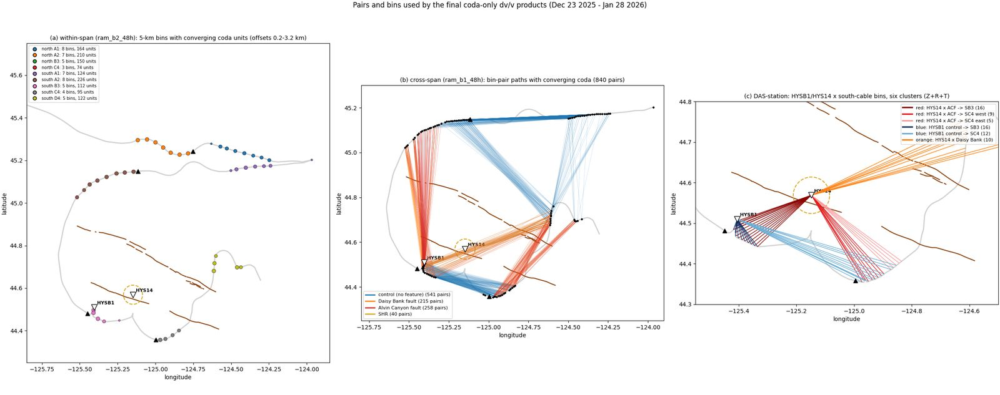

<sub>The three monitoring products on the two OOI cables: <b>(a)</b> within a repeater span, <b>(b)</b> between spans (840 paths, crossing the Alvin Canyon and Daisy Bank faults and the Southern Hydrate Ridge), <b>(c)</b> fiber × seafloor seismometers HYSB1 / HYS14.</sub>

</div>

---

## What this is

In late 2025 Nokia Bell Labs ran a **multispan distributed acoustic sensing (DAS)** experiment on the two Ocean Observatories Initiative (OOI) Regional Cabled Array cables that leave Pacific City, Oregon. A normal DAS interrogator stops at the first optical repeater. This one reads **every repeater span with a single laser and a single clock**, which turns hundreds of kilometres of seafloor telecom fiber into thousands of strain sensors on one timebase.

This repository turns those recordings into:

- 🌊 **Seismic velocity monitoring (dv/v):** three independent products (within-span, span-to-span, span-to-seismometer), coda only, 24-h and 48-h back-stacks, for Dec 23 – Jan 28 and Nov 6 – Dec 17.
- 🗺️ **Structure:** ambient-noise surface-wave tomography of Hydrate Ridge and shear-velocity depth profiles.
- 📡 **Multi-span beamforming:** earthquake directions and locations that a single span cannot give.
- ⏱️ **A forensic look at the DAS clock:** dropped data chunks and setup-dependent latency, with fixes.

The complete write-up, with every figure and test, is `docs/report/index.html` (open it in a browser).

---

## Highlights

<table>
<tr>
<td width="33%" align="center"><h3>0.80</h3>within-span stretching CC<br><sub>48 h, noise floor 0.019 %, 98 % of an injected change recovered</sub></td>
<td width="33%" align="center"><h3>1–6°</h3>M6.0 back-azimuth error with multiple spans<br><sub>single spans: 2–142°</sub></td>
<td width="33%" align="center"><h3>13 km</h3>M6.0 epicentre from fiber back-projection<br><sub>single spans: 50–310 km</sub></td>
</tr>
<tr>
<td align="center"><h3>±0.01 %</h3>dv/v resolution, cable averages<br><sub>even/odd noise floor, 48-h stacks</sub></td>
<td align="center"><h3>9°</h3>median teleseism direction error, both cables<br><sub>7 of 8 within 20° (Rayleigh waves)</sub></td>
<td align="center"><h3>16 min</h3>worst timing error from dropped chunks<br><sub>fixed from per-chunk metadata</sub></td>
</tr>
</table>

---

## 1 · Stable coda-wave dv/v from the fiber

Noise correlations were computed for 1-km fiber bins, with running-absolute-mean normalisation and spectral whitening. The coda windows start only after the measured end of the ballistic arrivals on every path, so dv/v measures scattered waves rather than shifts in the noise sources.

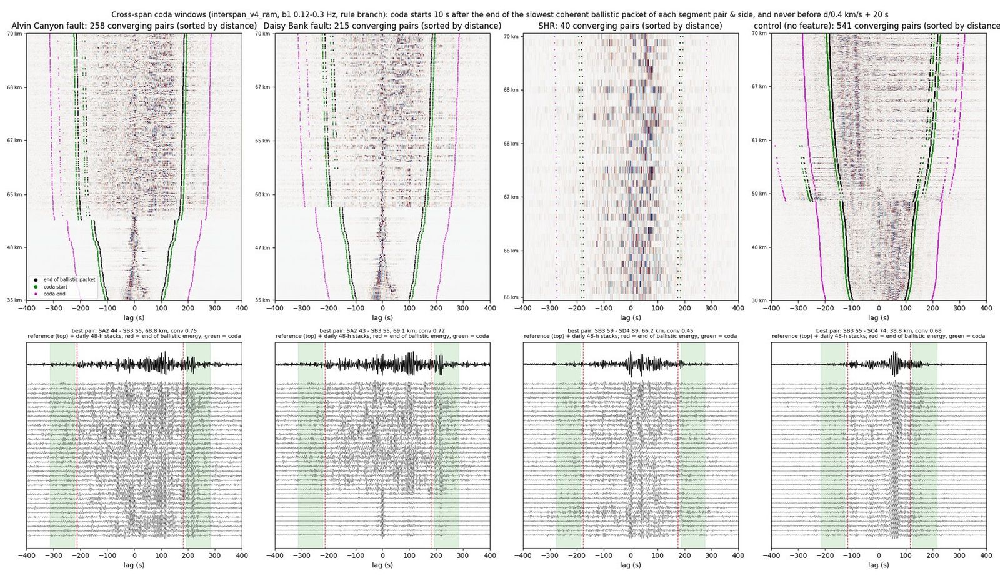

<sub>Span-to-span correlation functions sorted by distance, for paths across the Alvin Canyon fault, the Daisy Bank fault, Southern Hydrate Ridge and control paths. Black = end of the ballistic packet, green = start of the coda window. Bottom: the best pair of each group, day by day; its coda stays stable for five weeks.</sub>

| Product (48 h, Dec 23 – Jan 28) | Stretching CC | Noise floor | Injected 0.5 % change recovered |
|---|---|---|---|
| Within-span (0.2–3.2 km offsets, 0.3–0.7 Hz) | **0.80** | 0.019 % | 98 % |
| Span-to-span (5–70 km paths, 0.12–0.3 Hz) | **0.53** | 0.013 % | 81 % |
| Span-to-seismometer (HYSB1 / HYS14) | **0.65** | 0.071 % | 94 % |

<details>
<summary><b>dv/v time series</b> (click to expand)</summary>

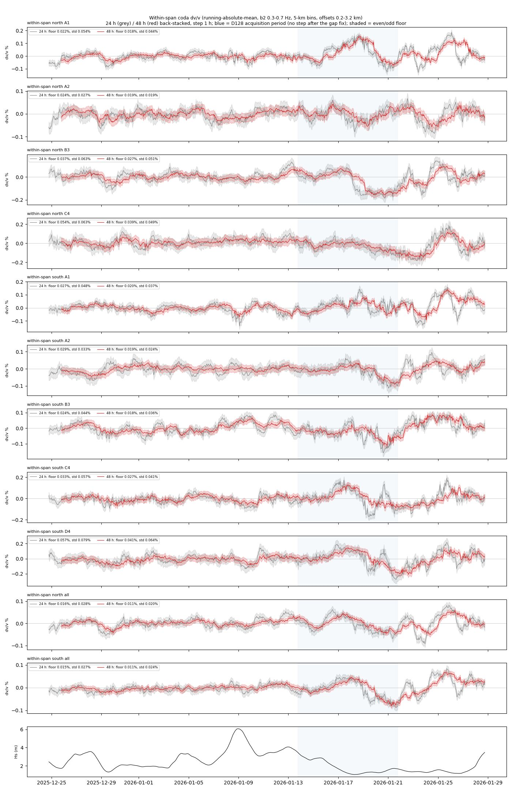
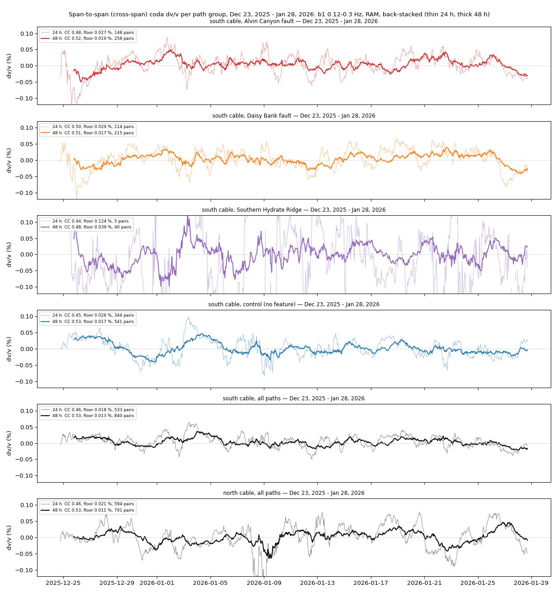
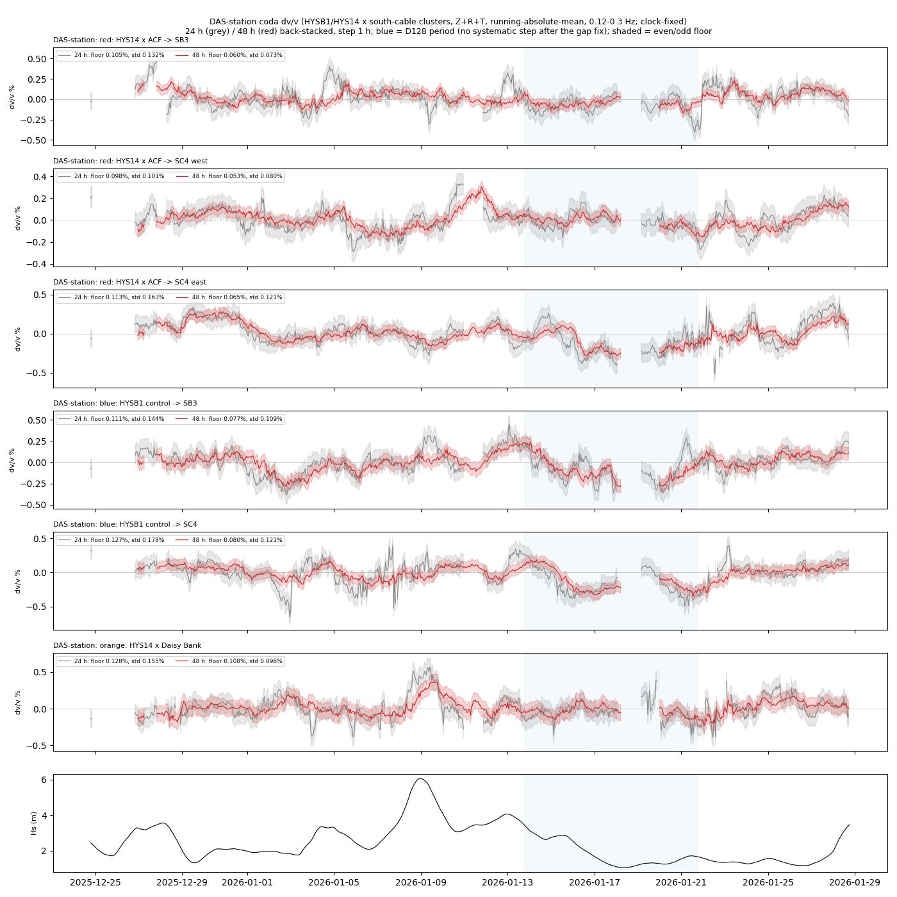

</details>

**What we learned**
- **No fault-specific signal:** paths across the Alvin Canyon and Daisy Bank faults vary like the control paths.
- **An unexplained episode:** within-span dv/v was very quiet on Dec 23 – Jan 13 and more variable on Jan 13 – 28. It is not explained by ocean waves, bottom pressure or temperature, or changes in the noise-source direction.
- **November confirms it is unusual:** six weeks of November data behave like the quiet period.

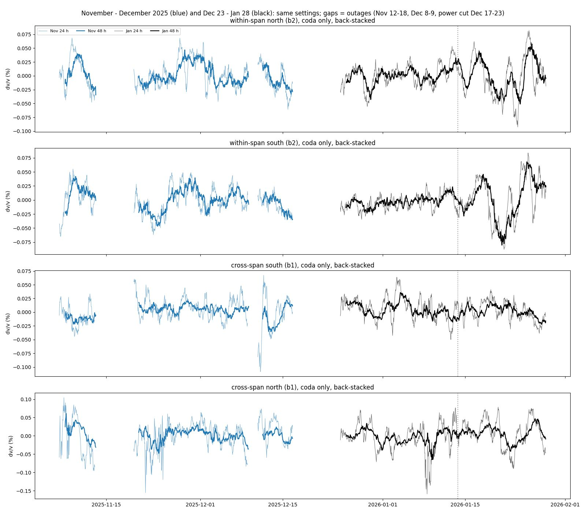

<sub>November (blue) and January (black), processed with identical settings. November reproduces January's quality; the variability after Jan 13 stands out.</sub>

---

## 2 · Structure: Hydrate Ridge in surface waves

Ambient-noise Scholte/Rayleigh group-velocity tomography combines span-to-span and fiber-to-seismometer paths. It shows a fast corridor along Hydrate Ridge and the Alvin Canyon fault zone, with slow sedimentary basins to the north and northwest.

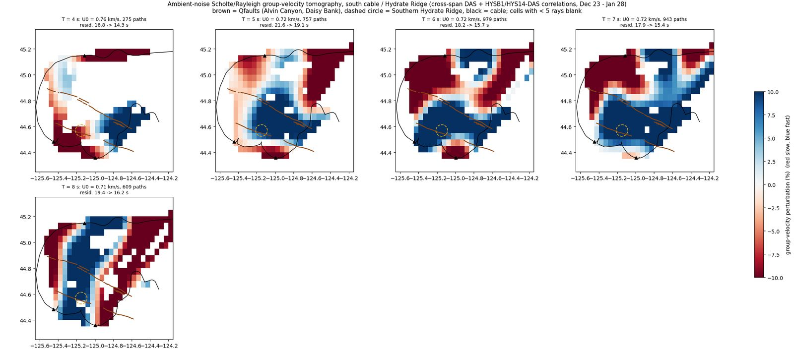
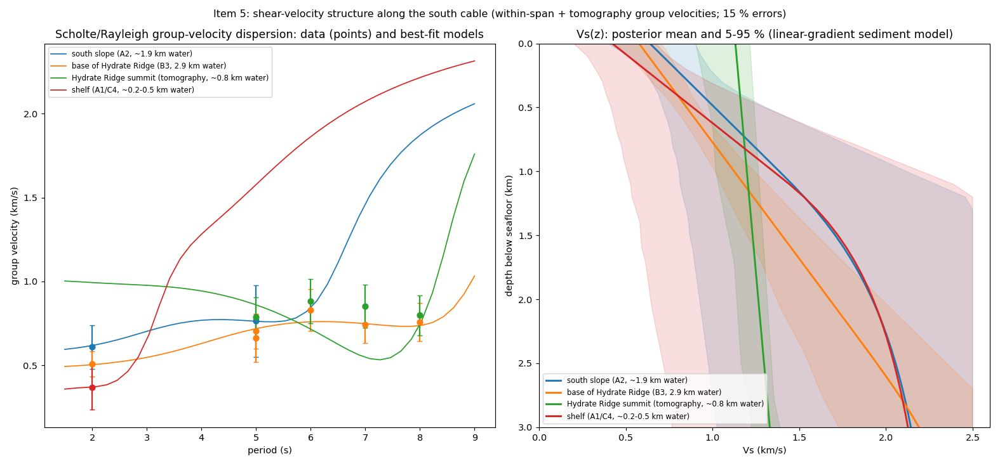

<sub>Shear velocity at the base of Hydrate Ridge (2.9 km water depth): 0.63 km/s at 0.1 km below the seafloor, 0.85 at 0.5 km, 1.13 at 1 km and 1.67 at 2 km.</sub>

---

## 3 · Multi-span beamforming: what one laser across many spans buys you

A single span is a line array: it cannot tell which side of the cable a wave came from, and its beams are 30–120° wide. Because all spans share one clock, they can be beamformed together as a single 2-D array.

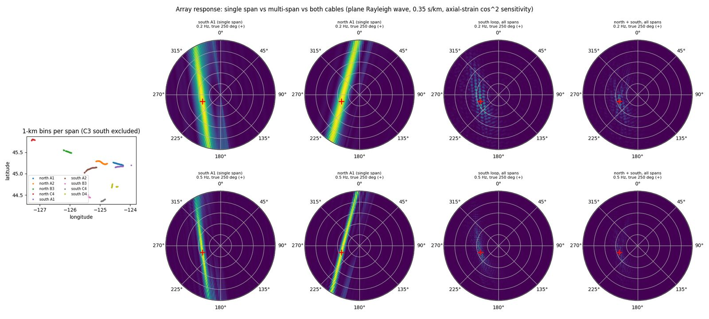

<sub>Synthetic array response. A single span gives a long ridge with an equally strong mirror image; the south loop and both cables together give one compact peak.</sub>

**On real earthquakes**

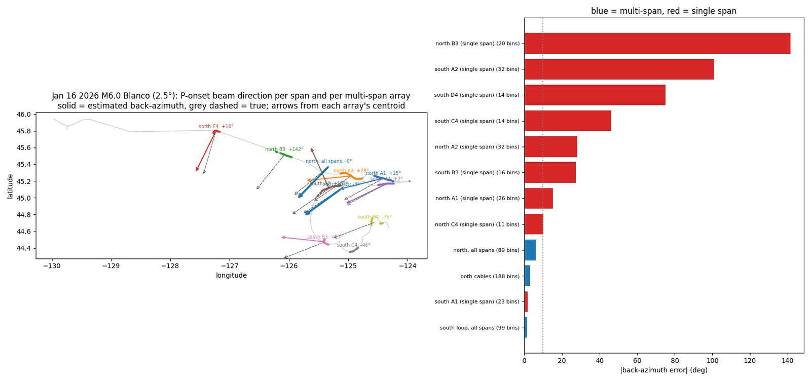

<sub>Jan 16 2026 M6.0 on the Blanco Transform. Arrows show the direction each single span estimates (colours) and each multi-span array (blue), against the true direction (dashed). Multi-span arrays are 1–6° off; single spans are off by up to 142°.</sub>

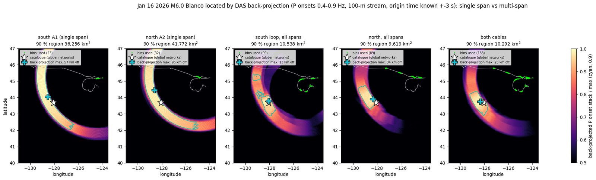

<sub>Back-projection with absolute timing. A single span only constrains an arc of possible positions; all spans together locate the epicentre within 13 km (south loop) to 34 km.</sub>

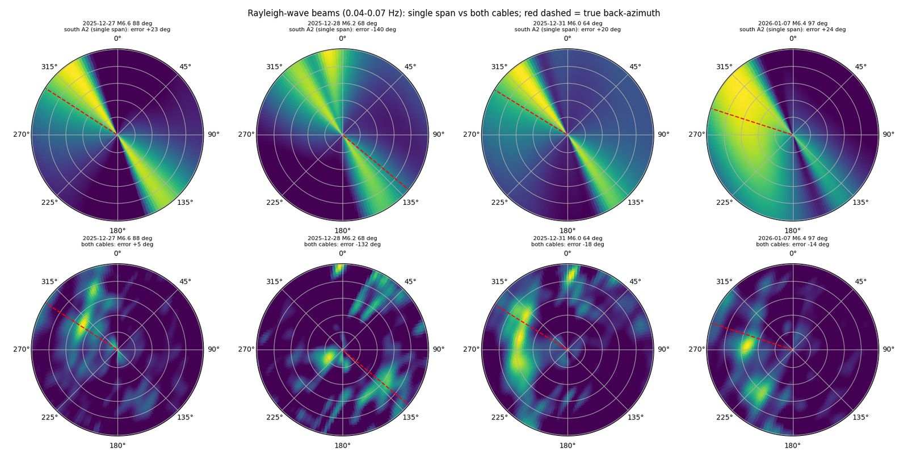

<sub>Teleseismic Rayleigh waves at 0.04–0.07 Hz, whose wavelengths are longer than any single span. Top: one span (broad, two-sided). Bottom: both cables (compact; median error 9°). Combining the cables required flipping the north cable's polarity, which this test discovered.</sub>

The same beams also map the ambient-noise field: the 0.16–0.20 Hz microseism arrives from the open Pacific all period.

<details>
<summary><b>Hourly noise direction</b></summary>

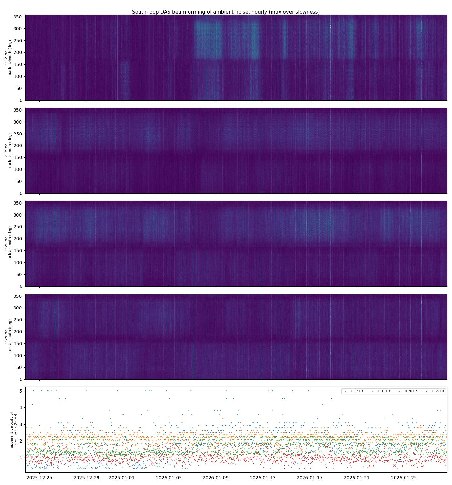

</details>

**What did not work** (documented in the report)
- **Rupture imaging:** imaging the M6.0 rupture (about 20 km long) is below the array's resolution.
- **Small local events:** an ML 2 and an M3 give a rough direction (±30°) but no robust location from envelope timing.
- **Fault crossings:** the fiber at both fault crossings is non-physical in every configuration tested.

---

## 4 · The DAS clock

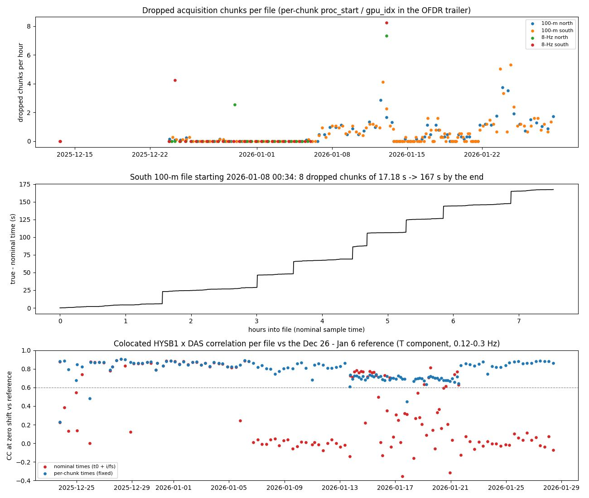

- **Dropped chunks:** the interrogator sometimes drops whole data chunks without leaving a gap in the stored array. Timing samples as `start + i/fs` drifts by up to **16 minutes** per file. Every drop is recorded in the file trailer, so true times are recoverable (`msdvv.raw.sample_times`).
- **Latency to UTC per acquisition setup:**

  | Setup | Latency |
  |---|---|
  | 100-m stream | +25.2 s |
  | Jan 13–21 | +11.8 s |
  | 8-Hz stream | +5.8 s |
  | Nov 6–26 | +11.3 s |
  | Nov 26 – Dec 17 | +15.6 s |

  Setups differ by whole data units.
- **Full note:** `docs/DAS_clock_note.md`. The checklist of every dataset issue and its correction is `docs/DATA_QUALITY.md`.

---

## Repository layout

```
msdvv/                 core package: raw reader with true per-chunk times, I/O and regridding, correlation, coda windows,
                       stretching, cross-span and DAS–seismometer tools
scripts/
  d00–d06_*.py         download (OOI archive, FDSN), stream reduction, joining short files
  s00–s80_*.py         analysis steps (inventory → quality → correlations → dv/v → structure → beamforming → November)
  adhoc/               one-off diagnostics referenced in the report
runs/                  run chains that reproduce the products
config_*.yaml          settings per data set (January 100-m stream, November, pilot)
resources/             cable routes, repeater locations, fault traces, oceanic travel-time model
docs/
  report/index.html    the full report (self-contained) + build steps
  REPRODUCE.md         report section → script → settings → run order
  DATA_QUALITY.md      known dataset issues and how to correct them
  DAS_clock_note.md    dropped chunks and latency, for the data providers
  PROJECT_LOG.md       detailed technical log of every step and decision
  environment_*.yml    conda environments (noisepy2; pyfetch for SeisBench / disba)
tests/                 unit tests (lag sign, band round-trip, dv/v recovery)
```

## Quickstart

```bash
conda env create -f docs/environment_noisepy2.yml && conda activate noisepy2

# January (Dec 23 – Jan 28), continuous 100-m stream
python scripts/d00_download.py                                   # mirror the OOI archive (~3 GB/day)
MSDVV_CONFIG=config_100m_v2ram.yaml python scripts/s00_inventory.py   # ... then s01–s05
bash runs/run_final_rebuild.sh                                   # correlations + coda dv/v (24 / 48 h, injection test)

# November (Nov 6 – Dec 17)
bash runs/run_nov.sh && bash runs/run_nov_short.sh && bash runs/run_nov_obsdas.sh
```

Every report figure, with its script and settings, is listed in `docs/REPRODUCE.md`. Paths default to `/data/wsd02/multispan_dvv`; edit the configs for another machine.

---

## Data (not in this repository)

No data or large outputs are committed. Everything below lives on the processing machine under `/data/wsd02/multispan_dvv/` (about 450 GB in total). It can be regenerated from the public archives with the download scripts, then the run chains. Paths are set in the `config_*.yaml` files and, for some scripts, hard-coded to `/data/wsd02/multispan_dvv`; edit them for another machine.

| Folder | Size | What it is | Source / how to regenerate |
|---|---|---|---|
| `raw/YYYY/MM/DD/{north,south}-100m/` | 111 GB | Continuous **100-m stream**: raw OFDR binaries with per-chunk trailer metadata; 105.9 m channels, 1.86 Hz (3.73 Hz on Jan 13–21); Dec 23, 2025 – Jan 28, 2026; both cables | OOI archive `piweb.ooirsn.uw.edu/das25` (`scripts/d00_download.py`, `config_100m*.yaml`) |
| `raw_hf/sample/` | 27 GB | **8-Hz stream** snapshots (7.45 Hz, 211.7 m), January 2026; the input of the original pilot | Same archive |
| `raw_hf/eq20260113/`, `eq20251213/`, `eq20251123/` | 2.5 GB | 8-Hz stream files around local earthquakes: Jan 13 ML 2.0, Dec 13 ML 1.6, Nov 23 M3.2 Amity | Same archive, downloaded per event |
| `raw_nov/reduced/YYYY/MM/DD/<cable>/` | 42 GB | **November – December 2025** (Nov 6 – Dec 17) 8-Hz stream reduced to the 100-m-stream channels (105.9 m, 1.86 Hz, float16 strain rate + per-channel scale + valid mask) | Archive `north`/`south` 8-Hz stream, `scripts/d05_stream_reduce.py` with `config_nov.yaml` |
| `raw_nov/crossings/` | 1.5 GB | Native 52.9-m cut-outs around the Alvin Canyon and Daisy Bank fault crossings (south cable, Nov 26 – Dec 2) | `d05_stream_reduce.py` (`crossing_cutout` in `config_nov.yaml`) |
| `raw_nov/merged_short/` | 15 GB | The 9.6-min Nov 26 – Dec 2 files joined into 38-min pieces (needed for 600-s cross-span windows) | `scripts/d06_merge_short_files.py` |
| `raw_nov/obsdas_input/` | links | Links to the reduced files, with the short files replaced by the joined pieces (input of the November DAS–seismometer run) | See `docs/REPRODUCE.md` |
| `raw_nov/sample/` | 5.4 GB | Example November files used to inspect the acquisition setups | Archive |
| `obs/continuous/YYYYMMDD/OO.<STA>.*.mseed` | 8.2 GB | OOI cabled seismometers HYSB1, HYS11–14 (20 Hz after decimation), Nov 6 – Dec 17 and Dec 23 – Jan 28, plus `OO_response.xml` | EarthScope/IRIS FDSN (`scripts/d04_download_obs.py`, gap fill `d04b_fill_obs_gaps.py`) |
| `obs/*.csv` | small | Deep-learning picks and detections from the seismometer scan, clock checks | `s61_obs_dl_scan.py` etc. |
| `outputs_100m/` | 25 GB | January products: DAS–seismometer correlations and coda dv/v (`obsdas_*`), events, tomography, beamforming (`beamform/`), earthquake location results, all figures (`figs/`, `figs/final/`) | Run chains (`docs/REPRODUCE.md`) |
| `outputs_100m_v2/` | 22 GB | January cross-span correlations (`interspan_v4_ram` south, `interspan_v6_north` north) and their coda dv/v (`interspan_coda/`) | `runs/run_final_rebuild.sh` |
| `outputs_100m_v2ram/` | 59 GB | January within-span correlations (RAM; `ccf/`) and their coda dv/v (`within_coda/`) | `runs/run_final_rebuild.sh` |
| `outputs_nov_ram/` | 87 GB | November within-span and cross-span correlations and dv/v; Nov vs Jan tables | `runs/run_nov.sh`, `runs/run_nov_short.sh` |
| `outputs_nov_obsdas/` | 19 GB | November DAS–seismometer correlations, latency calibration, timing check, coda dv/v | `runs/run_nov_obsdas*.sh` |
| `outputs_hf/` | 18 GB | Products of the January 8-Hz pilot (its correlation files were deleted as superseded) | `config_hf.yaml` |
| `logs/` | 2 MB | Logs of every run | — |

**Data conventions to know** (details in `docs/DATA_QUALITY.md`):
- Time samples from the per-chunk `stream.proc_start` or `stream.gpu_idx`, not from the file name or `start + i/fs`.
- Each acquisition setup has its own latency to UTC.
- The `masked` attribute gives the kept optical-distance intervals.
- The north cable's polarity is opposite to the south cable's.

---

## Acknowledgements and sources

- **DAS data:** Nokia Bell Labs multispan DAS experiment on the OOI Regional Cabled Array (University of Washington). Public record on Zenodo [10.5281/zenodo.19930402](https://doi.org/10.5281/zenodo.19930402) and [uwfiberlab/OOI_DAS_2025](https://github.com/uwfiberlab/OOI_DAS_2025). The cable routes, repeater locations and reader conventions in `resources/` come from there.
- **Seismometers:** OOI network `OO` (HYSB1, HYS11–14, Axial Seamount), via EarthScope / IRIS FDSN. Earthquake catalogues from USGS ComCat and PNSN. Faults from USGS Quaternary faults.
- **Software:** NoisePy (stretching reference), ObsPy, SeisBench (PhaseNet and EQTransformer, OBS-trained weights), disba.

## License

MIT; see `LICENSE`.
